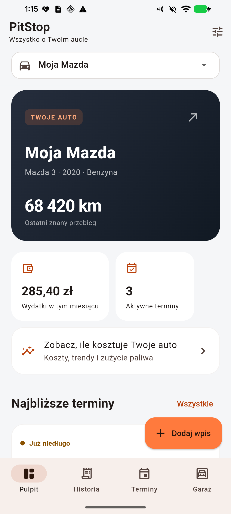
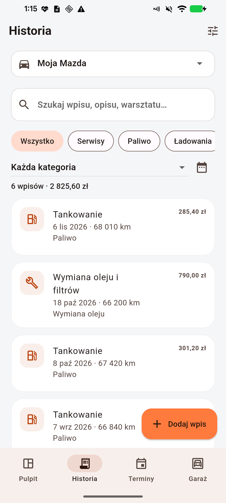
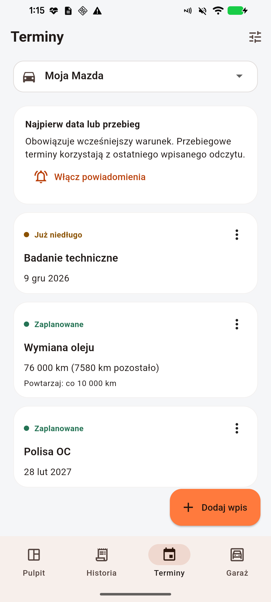
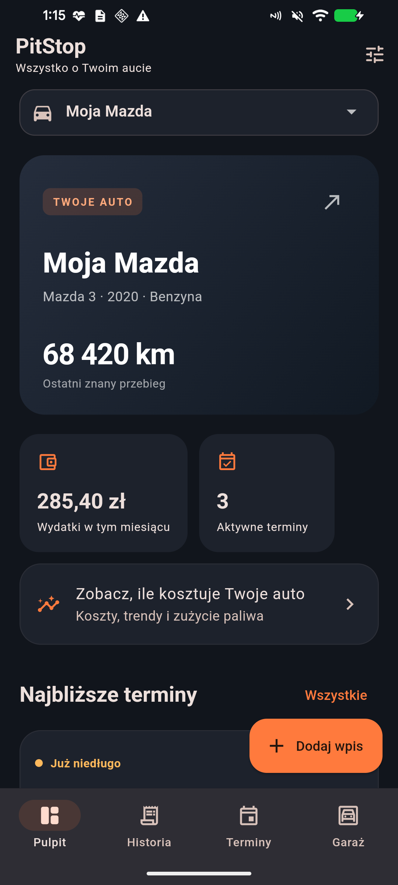
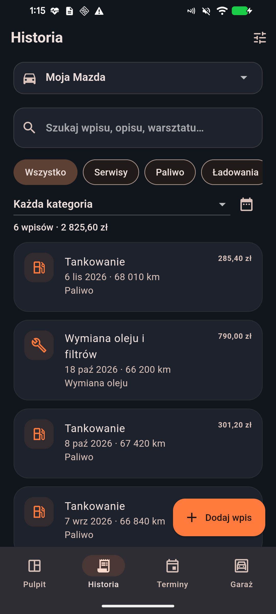
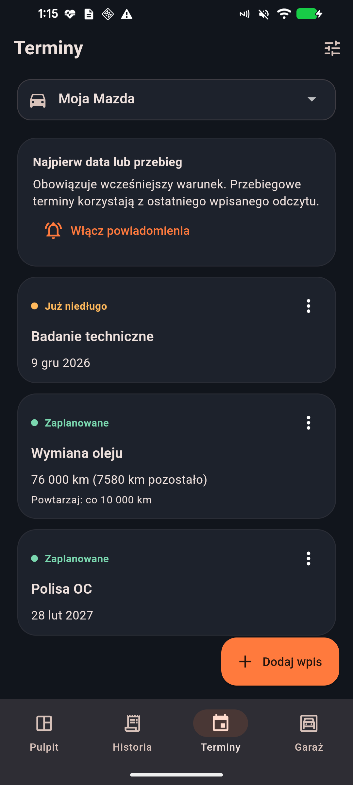

# PitStop 2.0

Darmowa, lokalna książka samochodu na Androida. Bez konta, reklam, abonamentu i limitów liczby aut. Dane zapisuje SQLite; wydanie release nie wymaga dostępu do internetu.

[Strona projektu](https://techparka.github.io/pitstop/) · [Kod źródłowy](https://github.com/techparka/pitstop)

## Zrzuty ekranu

Rzeczywiste zrzuty wersji 2.0 na Androidzie, wykonane z fikcyjnymi danymi demonstracyjnymi.

| Pulpit | Historia | Terminy |
|:---:|:---:|:---:|
|  |  |  |
|  |  |  |

## Funkcje

- Język polski i angielski. Domyślnie ten, którego używa telefon, z możliwością zmiany w Ustawieniach. Tłumaczone są też powiadomienia i raport PDF; nazwy plików oraz struktura CSV pozostają bez zmian.
- Kwoty w walucie pokazowej (PLN, EUR, CZK, NOK, SEK, UAH, GBP, CHF, DOP, TRY) z kursem wpisywanym ręcznie. Baza zawsze trzyma złotówki, więc zmiana waluty albo kursu nie przestawia historii.
- Pulpit wybranego auta, wspólna historia z wyszukiwaniem i filtrami, terminy oraz garaż.
- Serwisy z częściami i robocizną, kategoriami własnymi, zdjęciami i PDF; szablony podstawowych czynności i kopiowanie danych poprzedniego serwisu.
- Tankowania benzyny, diesla i LPG, częściowe i pominięte tankowania, osobne obliczenia dla każdego paliwa; ładowania w kWh.
- Pozostałe wydatki, odczyty przebiegu oraz statystyki miesiąca, roku i wybranego okresu.
- Przypomnienia datą i/lub przebiegiem, cykle miesięczne i kilometrowe, opcjonalny wpis serwisowy przy wykonaniu.
- Lokalne powiadomienia Androida: 7 dni i 1 dzień wcześniej oraz w dniu terminu. Harmonogram jest odtwarzany po restarcie telefonu. Przebiegowe alerty korzystają z ostatniego zapisanego odczytu, nie z telemetrii auta.
- Pełne kopie ZIP z kontrolą SHA-256, mediami, ustawieniami i plikami szkiców; bezpieczne przywracanie z kopią poprzedniego stanu. Pięć ostatnich kopii automatycznych, kopie ręczne i zapis przez systemowy wybór miejsca.
- Eksport/import CSV (UTF-8; separator `;` lub `,`), mapowanie kolumn, podgląd błędów oraz pomijanie ponownego importu identycznych wierszy.
- Raport PDF z podglądem, opcjonalnymi kwotami i danymi prywatnymi.
- Jasny, ciemny i systemowy motyw, szkice formularzy, ostrzeżenia o duplikatach i porzucaniu zmian.

## Integralność danych

Schemat 3 migruje wersje 1 i 2 bez kasowania historii. Nowe kwoty są przechowywane w groszach; stare koszty serwisowe przelicza migracja. Kolumna `cost` pozostaje lustrem dla zgodności dotychczasowych widoków, a `cost_cents` jest źródłem sum w nowej historii i raportach. Serwis z pozycjami ma jeden koszt całkowity; pozycje nie są osobnymi wydatkami.

Zapis serwisu, pozycji, załączników i podniesienia przebiegu jest transakcyjny. Pliki przygotowywane są przed zatwierdzeniem; błąd nie pozostawia częściowego wpisu. Usunięcie pliku sprawdza jego pozostałe powiązania. Niższy odczyt historyczny nie obniża licznika auta.

Kopia ZIP zawiera `manifest.json`, `data.json` i `media/`. Przywracanie sprawdza wersję, sumy plików, dozwolone ścieżki, kolumny i powiązania bazy. Pliki są najpierw przygotowywane w osobnym katalogu, a wymiana rekordów odbywa się w transakcji. Obsługiwany jest format ZIP 1 dla schematu 3, do 200 MB archiwum / 500 MB po rozpakowaniu. Kopie nie są szyfrowane; należy przechowywać je w wybranym przez siebie bezpiecznym miejscu.

## Obliczenia

Spalanie wymaga dwóch pełnych tankowań tego samego paliwa. Pierwsze jest punktem startowym; sumowane są litry kolejnych tankowań aż do następnego pełnego. Pominięte tankowanie rozpoczyna nowy odcinek. Benzyna i LPG nie są łączone w jeden wskaźnik. Dla ładowań rejestrowane są kWh i koszty, bez zgadywania zużycia na podstawie nieznanego stanu baterii.

Koszt/km obejmuje koszty między pierwszym i ostatnim odczytem w wybranym okresie. Aplikacja pokazuje zakres oraz dystans; bez odpowiednich danych nie wyświetla wskaźnika. Kwoty zerowe są prawidłowe; brak kosztu pozostaje brakiem danych.

## Uruchomienie i testy

Projekt działa na Flutter 3.16.9 / Dart 3.2.6; zależności są zapisane w `pubspec.lock`. Android: JDK 17, SDK 35, Gradle 7.5, Android Gradle Plugin 7.4.2, Kotlin 1.8.22.

```powershell
flutter pub get
dart run build_runner build --delete-conflicting-outputs
flutter gen-l10n
flutter analyze
flutter test
flutter build apk --release
```

`flutter gen-l10n` jest wymagane, bo na tej wersji SDK ani `flutter analyze`,
ani `flutter test` nie generuje lokalizacji: bez `lib/l10n/generated/` kod się
nie kompiluje. Szczegóły architektury PL/EN, słowników bazy i walut opisuje
[docs/l10n.md](docs/l10n.md).

APK: `build/app/outputs/flutter-apk/app-release.apk`. Aktualizacja istniejącego pakietu:

```powershell
adb install -r build/app/outputs/flutter-apk/app-release.apk
```

Nie używaj odinstalowania ani `pm clear` do aktualizacji, ponieważ usuwają dane aplikacji.

## Ograniczenia wydania

Android jest platformą odbioru. Projekt iOS pozostaje w repozytorium, ale wymaga osobnego sprawdzenia; mostek powiadomień, zapisu plików i generowania PDF jest obecnie zaimplementowany na Androidzie. Kopia lokalna nie chroni przed utratą telefonu, dlatego regularnie eksportuj ZIP poza urządzenie. Android może opóźniać powiadomienia podczas oszczędzania energii; nie są to alarmy wymagające zgody na dokładny czas.

Nie ma serwera, synchronizacji, cen paliw, diagnostyki OBD ani śledzenia GPS. Interwały serwisowe ustala użytkownik według zaleceń producenta samochodu.

APK używa identyfikatora `com.example.car_service`; obecna konfiguracja Gradle podpisuje kompilację release kluczem debug. Aktualizacja zachowa dane tylko wtedy, gdy podpis będzie zgodny z już zainstalowaną aplikacją. Publikacja sklepowa wymaga osobnego przygotowania identyfikatora i podpisu dystrybucyjnego.

Licencja: MIT (patrz LICENSE); biblioteki zachowują własne licencje.
